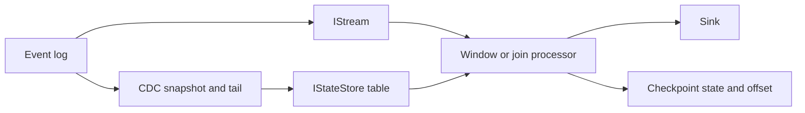

# Streaming and derived data

Boutquin.Storage provides a single-process reference pipeline for replayable streams,
event-time windows, joins, local state, checkpoints, and idempotent output. The pieces
compose with event logs, change data capture (CDC), and projections without claiming a
distributed stream-processing runtime.



## Event time, processing time, and watermarks

`StreamRecord<T>` carries a source offset, an event timestamp, and the value. The
timestamp records when the event occurred. Processing time is when the local process
enumerates it. Delayed or reordered delivery can therefore make event time move backward
while processing time always moves forward.

`BoundedOutOfOrdernessWatermarkPolicy` tracks the greatest observed event timestamp minus
an allowed delay. Its watermark is monotonic. A window is eligible for output when its
exclusive end is at or before the watermark. The policy is stateful and externally
synchronized; one `WindowedAggregator` owns it for one active enumeration. The aggregator
rejects concurrent executions on the same instance and resets the policy before a new run.

The built-in assigners use UTC, half-open intervals:

- A tumbling window assigns one non-overlapping interval.
- A sliding window assigns every overlapping interval selected by its slide.
- A session window starts at one event and ends after its inactivity gap. Overlapping or
  touching sessions for the same key merge.

Late-event behavior is explicit. `Drop` counts and discards the record. `Throw` stops the
run. `Include` updates state. A late update to an already published fixed window emits an
`Upsert`. A late session event can bridge published sessions; the processor emits a
`Retraction` for every superseded window followed by an `Upsert` for the merged window.
Consumers that materialize window output must apply those change kinds, rather than append
every emission as a distinct result.

## State, checkpoints, and replay

`IStateStore<TKey,TValue>` holds processor-local tables. `InMemoryStateStore` is concurrent
and snapshots by copying its current dictionary. It does not survive process failure;
choose a durable implementation when derived state cannot be rebuilt from its source.

`ICheckpointStore` persists one stream offset and an opaque state blob. The checkpointed
processors require a zero-based, contiguous source. On restart they load state at offset
`n` and resume at `n + 1`. Negative offsets below `-1`, `long.MaxValue`, gaps, duplicates,
and terminal offsets fail closed before output. State serialization also completes before
an output is published, so a codec failure cannot create an effect that the configured
processor can never checkpoint.

The transition delegate is a pure fold: it treats its input state as borrowed and immutable
and returns the next state plus output. Mutating a referenced input state in place breaks
failure replay because an unsuccessful transition could change the caller-visible state.
Only one `RunAsync` call may use a processor instance at a time.

`AtLeastOnceProcessor` publishes output, then saves state and offset. A crash between those
steps repeats the output after restart. `EffectivelyOnceProcessor` uses the stable operation
ID `<processor-id>:<offset>` with `IIdempotentStreamSink`; replay still repeats computation,
but a durable sink that remembers operation IDs suppresses the duplicate effect. The bundled
in-memory sinks demonstrate the contracts and are thread-safe, but lose their contents and
deduplication keys when the process exits. These processors do not claim atomic exactly-once
transactions across an arbitrary sink and checkpoint store.

## CDC tables and joins

`CdcStateTableUpdater` applies `Snapshot`, `Insert`, `Update`, and `Delete` records in source
order to an `IStateStore`. A bootstrap must establish a snapshot boundary at the source,
apply the complete snapshot through that boundary, and then consume the tail from the next
position. Without a source-provided boundary, a snapshot plus concurrent tail is not an
atomic view and can miss or duplicate changes.

`StreamTableJoin` looks up the latest applied table value for each stream record. The result
therefore depends on how far the CDC updater has advanced when the lookup occurs.
`TableTableJoin` joins copies of two tables captured sequentially; each copy is internally
consistent, while the pair is not an atomic cross-table snapshot. `StreamStreamJoin` buffers
two finite inputs and matches equal keys inside a symmetric event-time tolerance. It is a
finite replay reference, not an unbounded distributed join.

Join outputs retain source or provenance offsets. Stream-stream matches can share offsets or
appear in a non-contiguous sequence, so they are not valid direct input to a checkpointed
processor that requires contiguous offsets. Append join results to a fresh `IEventLog<T>` to
assign a new contiguous output position before checkpointed downstream consumption.

## Projections and materialized views

Projections and stream processors are two forms of derived data. A projection folds every
event into a read model and checkpoints its state. A materialized aggregate view applies the
same idea to column batches and incremental log refresh. Streaming adds event time, windows,
watermarks, and joins. All three rely on the same recovery boundary: durable input position
plus state that corresponds exactly to that position.

Run the sample and focused benchmark with:

```bash
dotnet run --project src/Samples -- streaming
dotnet run -c Release --project benchmarks/StorageEngine -- --streaming-only
```

The benchmark compares a direct processing-order sum with the watermark, window-state, and
asynchronous-enumeration overhead of `WindowedAggregator`. The operator processes one record
at a time, retains window state for the finite replay, and does not use or claim SIMD.

The checked-in [measured baseline](../benchmarks/StorageEngine/StreamingWindow.baseline.json)
records all four executed cases on .NET SDK 10.0.401 and Apple M4 hardware. The 4,096-record
means were 5.546 microseconds for the direct loop and 981.567 microseconds for the event-time
operator. The 65,536-record means were 93.827 microseconds and 90.289 milliseconds,
respectively. These methods provide different semantics, so the measurements characterize
the additional behavior and are not a speedup or ratio gate.
